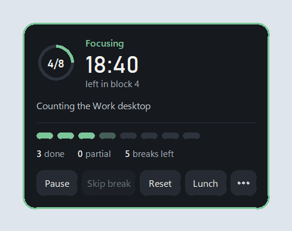
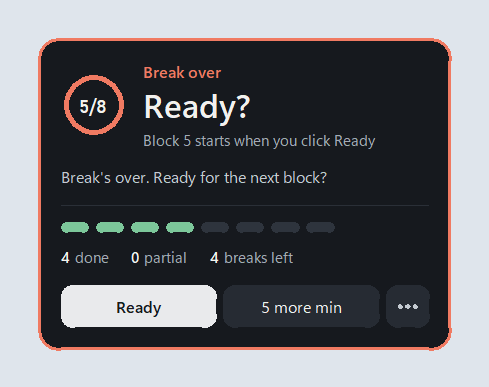
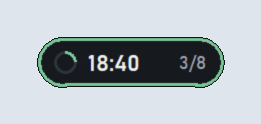
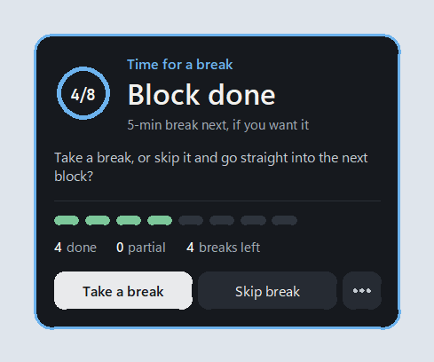
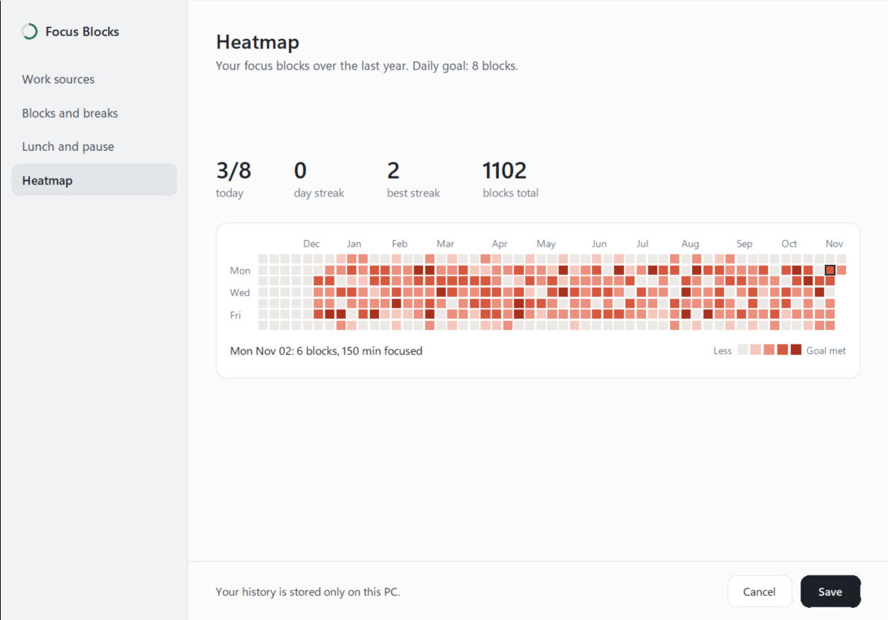
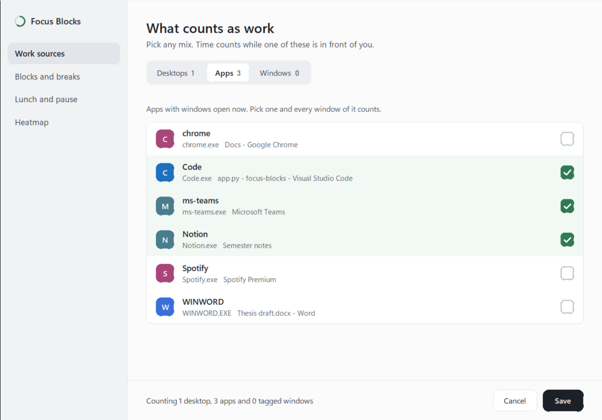
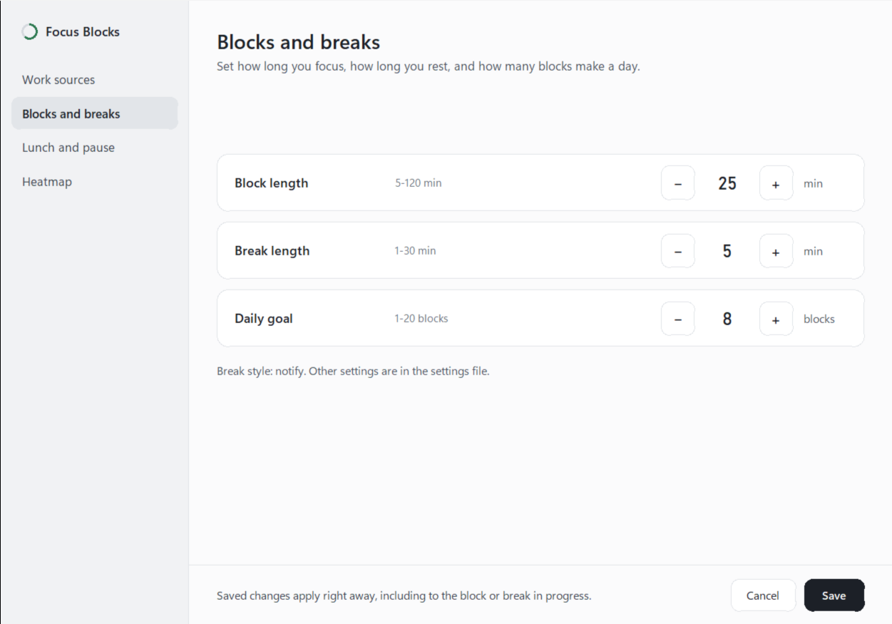

# Focus Blocks

**An automatic focus timer for Windows.** It notices when you're actually working, counts your focus time
in blocks, tells you when to take a break, and shows a year of your focus days as a heatmap.
You don't start or stop a timer: it just runs.

<p align="center">
  
  
</p>

[**⬇ Download the installer**](https://github.com/ajayboopalan/focus-blocks/releases/latest) ·
[How it works](#how-it-works) · [Install](#install) · [Use cases](#use-cases) · [FAQ](#faq) ·
[Contributing](#contributing) · [Support](#support-the-project)

---

## The problem

Timers like Pomodoro work, but only if you remember to use them. In practice:

- **You forget to start the timer**, or forget to stop it when you get pulled into chat, email or YouTube,
  so the numbers you get don't match the work you did.
- **You skip breaks.** Two hours later your eyes hurt, your back hurts, and your focus is gone.
- **You take a 5-minute break that becomes 40 minutes**, because nothing tells you the break is over.
- **At the end of the day you can't say how much real focus you got**, and you have no idea whether this
  week was better than last week.

## How Focus Blocks solves it

| Instead of... | Focus Blocks... |
| --- | --- |
| Starting and stopping a timer | **Counts only while a work source is in front of you**: a virtual desktop, an app (VS Code, Word, Notion...) or a window you tag. Switch to something else and it holds; come back and it resumes. |
| Counting time you weren't there | **Pauses after 3 minutes with no keyboard or mouse input**, so coffee runs and chats don't count. Meetings still count: if your mic or camera is in use (read from Windows' privacy settings, the camera is never opened). |
| Skipping breaks | **Asks at the end of every block**: take a break, or skip it if you're in the zone. |
| Breaks that never end | **When the break is over, it opens and asks "Ready?"** Nothing counts until you click Ready, or add 5 more minutes. |
| Guessing how your week went | **Shows a year-long heatmap** with your daily goal, current streak and best streak. |
| Losing the timer window | **A small always-on-top pill** with a coloured outline in the current status colour: green focusing, blue break, orange lunch, grey paused. |

Everything stays on your PC. No account, no cloud, no tracking of what you type or which sites you visit.

## Screenshots

| | |
| --- | --- |
| <br>**Collapsed pill.** Time left in the block and blocks done today. Hover it to open. | <br>**Block done.** Take a break or skip it. Nothing counts while it waits for you. |
| <br>**Focusing.** What's being counted, today's progress, Pause, Reset and Lunch. | <br>**Break over.** Ready starts the next block; 5 more min extends the break. |

**Heatmap** (Settings → Heatmap). Hover any day to see its blocks and minutes:



**What counts as work** (Settings → Work sources). Pick desktops, apps or tagged windows:



**Blocks and breaks.** Block length, break length and daily goal, applied right away:



*(Screenshots use demo data.)*

## Install

1. Download **`FocusBlocks-Setup-<version>.exe`** from the
   [latest release](https://github.com/ajayboopalan/focus-blocks/releases/latest).
2. Run it. It installs for your user only (no admin password needed).
   - Windows may show **"Windows protected your PC"** because the installer isn't code-signed yet.
     Click **More info → Run anyway**.
3. Keep **"Start Focus Blocks automatically when I sign in to Windows"** ticked, so it's there every
   morning without you thinking about it.

Requires Windows 10 or 11. To uninstall: **Windows Settings → Apps → Focus Blocks → Uninstall**.
Your history in `%USERPROFILE%\.focusblocks` is kept, so reinstalling picks up where you left off.

## Quick start (2 minutes)

1. **Find the pill.** It sits in the top-right corner of your screen. Drag it anywhere; it remembers.
2. **Tell it what counts as work.** Right-click the pill → **Settings... → Work sources**. Tick your work apps
   (VS Code, Word, Notion, Teams...) or a virtual desktop named e.g. "Work". If you tick nothing, every window counts.
3. **Set your rhythm.** **Settings → Blocks and breaks**: block length (default 25 min), break length
   (5 min) and daily goal (9 blocks). Click **Save**.
4. **Click Start** on the pill. That's it. Work as usual.

## How it works

```
 Start ──► Focusing ──(block length reached)──► "Take a break?" ──► Break ──► "Ready?" ──► Focusing ...
             │  ▲                                     │                          │
   left work │  │ back on work                  Skip break ──────────────────────┘ (5 more min ↺ Break)
             ▼  │
          Held (time doesn't count)        Daily goal reached ──► "Keep going?" (one bonus block) or Stop
```

- **Counting.** Time counts while a work source is in front of you and you've used the keyboard or mouse in
  the last 3 minutes, or while you're in a meeting.
- **Held.** Leave work (switch to a non-work app, walk away) and the block holds. If you're gone 15 minutes,
  the unfinished block is saved as *partial* and the next one starts fresh.
- **End of block.** The pill opens and gently hops until you choose **Take a break** or **Skip break**.
- **End of break.** The pill opens and asks **Ready?** Click **Ready** when you're back, or **5 more min**.
- **Daily goal.** After the block that hits your goal: **Keep going** (a break, then one bonus block) or **Stop**.
- **Lunch.** Click **Lunch** on the pill any time; tracking stops until you end it. Set a lunch time in
  **Settings → Lunch and pause** for a reminder. When you come back to your PC, it asks **Welcome back?**
- **Tag a window.** Press **Ctrl + Alt + W** on any window (say, one browser window with your docs) to count it as work.

Right-click the pill for: Start/Stop tracking, Settings, Heatmap, Tag this window, Reload settings, Quit.

## Use cases

**At work (developers, writers, analysts).**
Tick your editor, terminal and docs as work sources. Slack and email don't count, so your heatmap shows
deep-work time, not "time at the computer". Meetings count automatically while your mic or camera is on.
Use it to protect a daily target like *6 blocks of real focus* and to see which days get eaten by interruptions.

**While studying (students, exam prep, online courses).**
Make a virtual desktop called "Study" with your PDF reader, notes and course tab, and tick it.
Set 50-minute blocks with 10-minute breaks. The "Ready?" prompt keeps breaks from turning into hour-long
phone sessions, and the streak on the heatmap is a good reason not to skip a day.

**Working from home.**
The lunch reminder and "Welcome back" prompt give the day a structure. Starting with Windows means you never
forget to turn it on.

**Freelancers and side projects.**
Tag the client's windows with Ctrl + Alt + W, check the heatmap at the end of the week, and you know how much
focused time actually went into the project.

**Building a habit.**
Start with a small daily goal (say 4 blocks) and raise it as the streak grows. The heatmap makes progress visible.

## Settings reference

Most settings are in the Settings window. Everything lives in `%USERPROFILE%\.focusblocks\config.json`;
after editing it, right-click the pill → **Reload settings**.

| Setting | Default | What it does |
| --- | --- | --- |
| `block_minutes` | 25 | Length of a focus block |
| `break_minutes` | 5 | Length of a break |
| `more_break_minutes` | 5 | Minutes added by "5 more min" |
| `daily_goal` | 9 | Blocks per day |
| `work_desktops` / `work_apps` | `["Work"]` / `[]` | What counts as work (empty = everything) |
| `idle_seconds` | 180 | No input this long pauses the block |
| `abandon_minutes` | 15 | Away this long and the unfinished block is saved as partial |
| `count_meetings` | true | Mic or camera in use counts as work |
| `break_mode` | `"notify"` | `"overlay"` covers the screen during breaks (skippable) |
| `pause_resume` | `"manual"` | `"auto"`: a paused block resumes when you're back on work |
| `lunch_time` | `""` | e.g. `"12:30"` for a daily lunch reminder |
| `tag_hotkey` | `"ctrl+alt+w"` | Tag or untag the focused window |
| `desktop_previews` | true | Small screenshots of each virtual desktop for the Settings picker (stored locally) |

## FAQ

**Does it record what I type or which websites I visit?**
No. It only checks *how long since* the last key or mouse input, the name of the app in front, and the
virtual desktop name. Nothing leaves your PC.

**Does it use my webcam?**
No. To detect meetings it reads a flag Windows keeps for the privacy indicator ("app X is using the camera").
The camera itself is never opened.

**Where's my data?** `%USERPROFILE%\.focusblocks`: `focus.db` (SQLite), `config.json` and a log file.

**I can't find the pill.** Look for the coloured outline. It's always on top and shows on every virtual
desktop. If it's off-screen, delete `%USERPROFILE%\.focusblocks\pill.json` and restart it.

**Can I try it without touching my real stats?** Run it with `--test`: 1-minute blocks, 30-second breaks,
separate data, and a Test menu on the pill to jump to any moment.

## Contributing

Contributions are very welcome: bug reports, ideas, docs, translations and code.

- Found a bug or have an idea? [Open an issue](https://github.com/ajayboopalan/focus-blocks/issues).
- Want to code? See [CONTRIBUTING.md](CONTRIBUTING.md) for setup, architecture, tests and how to write an add-on.
- Good first ideas: a Settings page for the remaining `config.json` options, weekly/monthly reports,
  export to CSV, macOS/Linux support (the core engine is OS-independent).

If Focus Blocks helps you, a ⭐ on the repo helps others find it.

## Support the project

Focus Blocks is free and open source. If it saves you time and you'd like to say thanks,
you can buy me a coffee ☕. It's appreciated, never expected.

<!-- TODO: replace with your real link -->
**☕ Buy me a coffee:** *https://buymeacoffee.com/ajayboopalan*

## License

[MIT](LICENSE) © Ajay Boopalan
